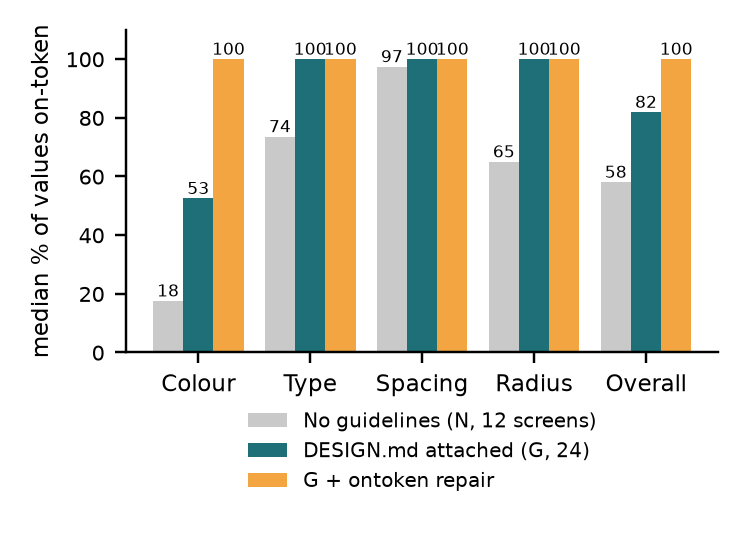
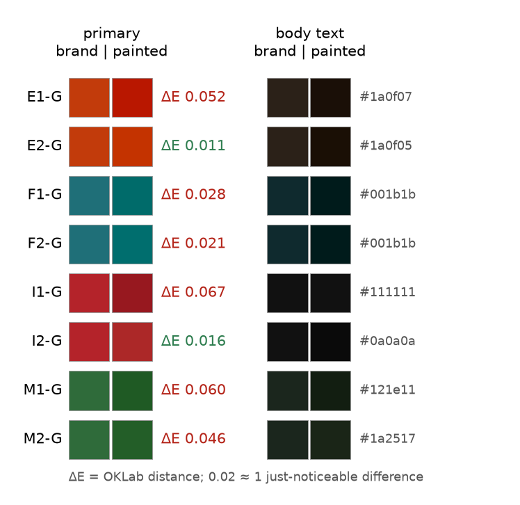
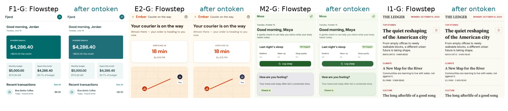

# Does the Brand Survive? Measuring and Enforcing DESIGN.md Adherence in Flowstep's AI-Generated UI

<div class="authors">Mouadh Abderrahmane Assal</div>
<div class="affil">thereviewboost@gmail.com · github.com/mouadhassal/ontoken</div>

<div class="abstract" markdown="1">

## Abstract

Flowstep lets a team attach a brand's DESIGN.md to a file, and its site says nothing drifts out of style. I measured how much of what Flowstep actually paints lands on the brand's tokens, and built a deterministic fixer for the rest.

**Method.** Flowstep screens reference theme variables whose values its API does not return. I therefore **recovered each file's theme from Flowstep's own PNGs** with sentinel rendering. With the recovered theme, my renderer matches Flowstep's images to a median 2.2% of pixels. Every painted colour, font size, family, spacing and radius was scored against the tokens: 6,218 values in total. The study was **pre-registered** and sized to the 15-message free trial. It used four brands, 8 briefs with guidelines (G), 4 matched briefs without (N), and 2 drift edits.

**Findings.**

- **Guidelines work.** Median on-token colour rises from 18% (N) to 51% (G), and the other categories from 74% to 97%. Both tests give p < 0.005.
- **Flowstep re-tints the brand.** Its painted primary is darker than the DESIGN.md primary in **8 of 8 files**, and beyond one just-noticeable difference in 6. The same DESIGN.md produced different primaries in different files.
- **Every one of the 24 guided screens** has at least one off-token value.
- **Edits do not drift.** Colour adherence was 54%, 54% and 53% across two edits.
- **One brand font never renders.** Manrope is unavailable, and one file fell back to a Times-like serif.

**Repair.** `ontoken` snaps values to tokens by editing class strings only. It brought **33 of 36 screens to 100% on-token**, moving a median 6% of pixels, and introduced no contrast failure. Written back into Flowstep in place, 23 of 24 fixed screens were at least as on-brand in Flowstep's own renderer (median 0.993 to 1.000). Two pre-registered checks failed, and both are reported.

</div>

<div class="keywords">AI design tools · DESIGN.md · design tokens · evaluation · Tailwind · MCP · pre-registration</div>

<hr class="rule">

<div class="cols" markdown="1">

## 1. The question

A team that adopts an AI design tool hands over its brand: colours, type, spacing and corner shapes, written as tokens. Flowstep accepts these as a DESIGN.md (Google's open format) attached to a file. It injects them into every generation and promises that "nothing drifts out of style".

That promise is testable, and testing it is the kind of **evaluation-driven development** Flowstep's AI Engineer role asks for. I asked three things:

1. How much of the painted UI is exactly on the tokens, with and without guidelines?
2. Does it stay there through chat edits?
3. Can a cheap, deterministic post-pass close the gap without changing the design?

## 2. Method

**Generation.** Everything ran through Flowstep's public MCP server (`api.flowstep.ai/mcp`, OAuth 2.1 PKCE) from a TypeScript client. Every call is logged.

**Brands.** I wrote four DESIGN.md brands, each passing `@google/design.md lint` with 0 errors:

- **Fjord**, finance: teal, Inter;
- **Ember**, food: burnt orange, DM Sans, off-Tailwind sizes 13/15/17/22/28/34;
- **Moss**, health: green, Manrope, an 8-point scale with no 12 px step;
- **Ink**, editorial: red, Source Serif 4 headlines, sharp corners.

**Briefs.** Each brief asks for three screens and never mentions colour, type, spacing or shape. G and N receive identical briefs.

**Theme recovery.** Flowstep's JSX says `bg-primary` and `text-muted-foreground`, not hex values, and the API returns no theme. To find the colours:

1. Render each screen with every theme variable set to a unique sentinel colour.
2. Read what Flowstep painted at each sentinel's pixels; the mode wins.
3. Fit fonts and radius steps by pixel loss.

The calibrated render differs from Flowstep's PNG on a median 2.2% of pixels, against up to 15.7% with a default theme. The worst file is 20%, because I replace photos with grey.

**Measurement.** Every visible element yields its painted values:

- text, icon, background, border and gradient colours, composited over what is behind them;
- font size and family;
- padding, margin and gap above 2 px;
- radii where they show.

A colour is on-token if it is within ΔE<sub>OK</sub> ≤ 0.02 of a token, which is about one just-noticeable difference. A dimension is on-token within 0.5 px. Text also gets a WCAG AA contrast check.

**Repair.** Each off-token value snaps to the nearest token:

- colours use chroma-weighted OKLab, so a grey stays a grey, and are the nearest token that keeps AA;
- borders prefer `border`-role tokens;
- inherited colours are fixed where they are declared;
- the pass re-renders and repeats until stable, at most 4 passes.

Only `className` strings change, merged with tailwind-merge, and every other byte of the JSX is preserved.

**Pre-registration.** The protocol, metrics, repair rules and hypotheses were frozen in commit `af1b7d0`, with SHA-256 pins, before any confirmatory generation. The free trial allowed 15 messages, and the design used them as follows:

| Part | Files | Messages |
|---|---|---|
| Development | D1 (G) | 1 |
| Paired | F1, E1, M1, I1 × {G, N} | 8 |
| G only | F2, E2, M2, I2 | 4 |
| Drift | F1-G, two content-only edits | 2 |

## 3. Results

Table 1 gives every pre-registered verdict, frozen and amended (§3.6).

| | Hypothesis | Frozen | Amended |
|---|---|---|---|
| H1a | colour G > N | ✓ p=.002 | ✓ p=.005 |
| H1b | non-colour G > N | ✓ p=.0002 | ✓ p=.0005 |
| H2 | primary shifted (≥75% of files) | ✓ 6/8 | ✓ 6/8 |
| H3 | off-token values remain (≥75% of G screens) | ✓ 24/24 | ✓ 24/24 |
| H4a | ≥90% of screens fully repaired | ✓ 33/36 | ✓ 33/36 |
| H4b | AA failures down ≥80% | ✓ 205→2 | **✗ 8→2** |
| H4c | no new AA failure | ✓ 0 | ✓ 0 |
| H4d | median pixels moved ≤25% | ✓ 7.8% | ✓ 6.0% |
| H5 | round trip via `add-screen-jsx` | **✗ 18/24** | **✗ 18/24** |
| H6 | renderer median diff ≤3% | ✓ 2.2% | ✓ 2.2% |

<div class="caption">Table 1. Pre-registered verdicts. Wilcoxon signed-rank tests are exact and one-sided, on 12 screen pairs.</div>

<div class="fig" markdown="1">

<div class="caption">Figure 1. Median share of painted values on the brand's tokens, by category, over all 12 N and 24 G screens (amended analysis). H1 uses the 12 matched pairs, hence 51% there against 53% here.</div>
</div>

### 3.1 Guidelines help, a lot

Attaching the DESIGN.md roughly triples exact-colour use, from a median of 18% to 51%. Type, spacing and radius together rise from 74% to 97%.

Spacing is near-perfect even without guidelines (97%), because Tailwind's 4 px grid already matches most brand scales. Type is where guidelines matter most outside colour. Ember's off-Tailwind sizes were still missed in one file of two (E1-G: 42% of sizes on-token; E2-G: 100%).

### 3.2 Flowstep re-tints the brand

<div class="fig" markdown="1">

<div class="caption">Figure 2. The brand's primary and body-text colours against what Flowstep painted, for every guided file.</div>
</div>

In every one of the 8 guided files, the painted primary is **darker** than the token: ΔL<sub>OK</sub> from −0.005 to −0.064. In 6 files the shift exceeds one just-noticeable difference, with ΔE up to 0.067 (Ink: #B4232A painted as #97181F).

The same DESIGN.md yields **different** primaries in different files: Ember's #C23B0B came out as #B91700 in one file and #C43300 in another. The theme is evidently re-derived per generation rather than copied from the tokens.

Body text shows the same darkening: Fjord's `ink` #0F2A2E is painted #001B1B. Radius steps are re-scaled too. On the development file, `rounded-xl` painted 6 px where Flowstep's own internal prompt asked for 12 px.

### 3.3 Nothing drifts across edits

Two content-only edits on F1-G ("add a promotional banner", "add a secondary action") left the recovered theme identical, and left median colour adherence at 54%, 54% and 53%. On this sample, Flowstep's no-drift claim holds. With n = 1 file this is descriptive only.

### 3.4 One brand font never renders

Flowstep's PNG renderer painted Inter, DM Sans and Source Serif 4 correctly. **Manrope never rendered.**

M1-G writes `font-[Manrope]` with no fallback stack, so Flowstep paints a Times-like default serif. M2-G silently used Inter instead. A brand whose font is not in the renderer's set gets no warning. This finding is exploratory.

### 3.5 The repair

On the calibrated renderer, 33 of 36 screens reach 100% on-token with zero unrepairable values. The median screen moves 6% of its pixels, and almost none of them visibly: the median pixelmatch difference is 0.07%. No screen gains a contrast failure.

The 3 incomplete screens are all unguided and show two gaps in the repair:

- text faded with `opacity-70` stays faint after its colour is fixed;
- progress rings drawn as arbitrary `conic-gradient(…)` values are not rewritten.

<div class="wide" markdown="1">

<div class="caption">Figure 3. Flowstep's own render of four guided screens, original and after ontoken's repair is written back in place (amended repair). Layout, copy and fonts are untouched; colours and radii move onto the tokens.</div>
</div>

**Round trip.** H5 failed: only 18 of 24 screens added back with `add-screen-jsx` stayed at least as on-brand. The cause is structural. Flowstep stores the theme on each AI-generated screen, and a code-added screen starts from the default theme. Every on-token colour the repair left as a theme variable then turned white or black (Ember lost its cream and orange).

Writing the same JSX over the original screen with `replace-screen-jsx` keeps the theme. Then **23 of 24 screens** are at least as on-brand in Flowstep's own renderer, with the median flat-pixel brand adherence going from 0.993 to 1.000. The single "worse" screen moved by 0.000001, from 0.999769 to 0.999768.

### 3.6 What went wrong in my pipeline

Two bugs surfaced after the test run. Both are fixed in separate files, with the frozen code still pinned.

**Text colours.** Theme variables used only for text were recovered from thin glyph pixels, where the background often won. For example, Ink's `--foreground` came out as the paper colour. That produced 197 false contrast failures. The fix re-votes text variables with background pixels excluded, and now recovers Ink's text as #111111, the exact token. The fix turns H4b from pass to fail.

**Fonts.** The frozen repair wrote Tailwind v4's `font-[family-name:X]`, which Flowstep ignores, and inserted Manrope, which Flowstep cannot paint. In Flowstep, this turned Ink's serif headlines sans and Moss's text into Times. The amended repair writes `font-['X']` and never inserts a font Flowstep lacks.

## 4. What this suggests for Flowstep

1. **Copy tokens, don't re-derive them.** Map DESIGN.md colours to theme variables as given, and check the mapping with an automatic ΔE test. It is cheap and would have caught 6 of 8 files here.
2. **Make adherence an eval in CI.** `ontoken check` scores a screen in under 4 s from a cold start, and about 0.3 s per render in batch. Run it on a fixed prompt set per model or prompt change and track per-category rates.
3. **Load or reject brand fonts.** Use fallback stacks in emitted classes, and warn when a DESIGN.md font is unavailable.
4. **Let code-first screens inherit a theme.** `add-screen-jsx` could accept a theme or take the file's last one.
5. **Ship the snap pass as a guard.** It is deterministic, preserves layout and copy, and costs no model call.

## 5. Limitations

- **Sample size.** It is small: 36 screens and 6,218 values from 15 messages on one day and one model version.
- **Brands.** The four brands are my own. Real brands may define larger palettes and allow tints.
- **Renderer.** Mine is calibrated, not Flowstep's. Photos are replaced with grey, and recovered colours are modes over pixels.
- **Fonts.** The font findings rest on visual and pixel evidence from Flowstep's PNG export. The live editor may load fonts differently.
- **Amendments.** Two were made after the test run (§3.6). Both verdict sets are reported, and the frozen code is pinned.

## 6. Reproduce

```
npm ci && npx playwright install chromium
npx vitest run                     # 30 tests
npx tsx study/measure.ts --v2      # offline
npx tsx study/analyze.ts --v2
npx tsx src/cli.ts check screen.jsx --design brand.md
```

Fresh generations need a Flowstep account: `npx tsx study/run.ts --phase test`.

</div>
